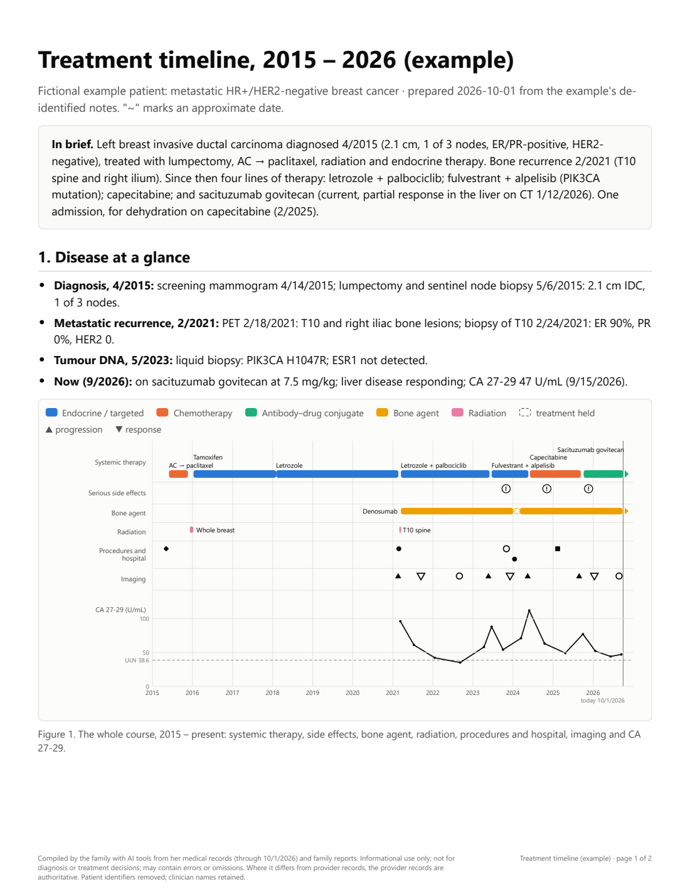
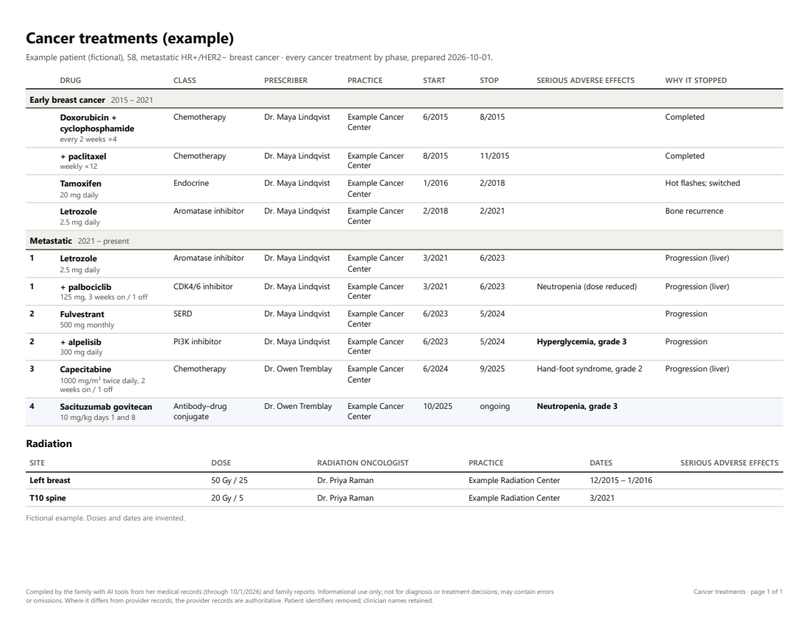
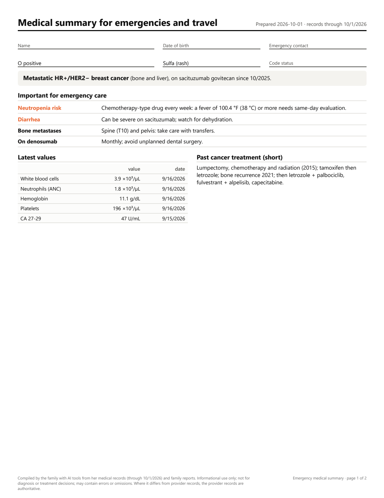
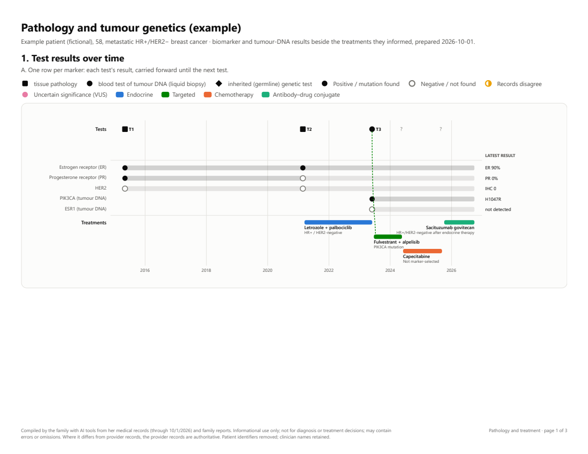
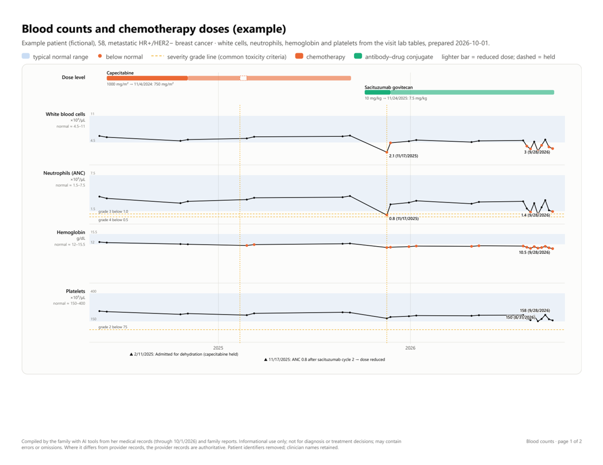
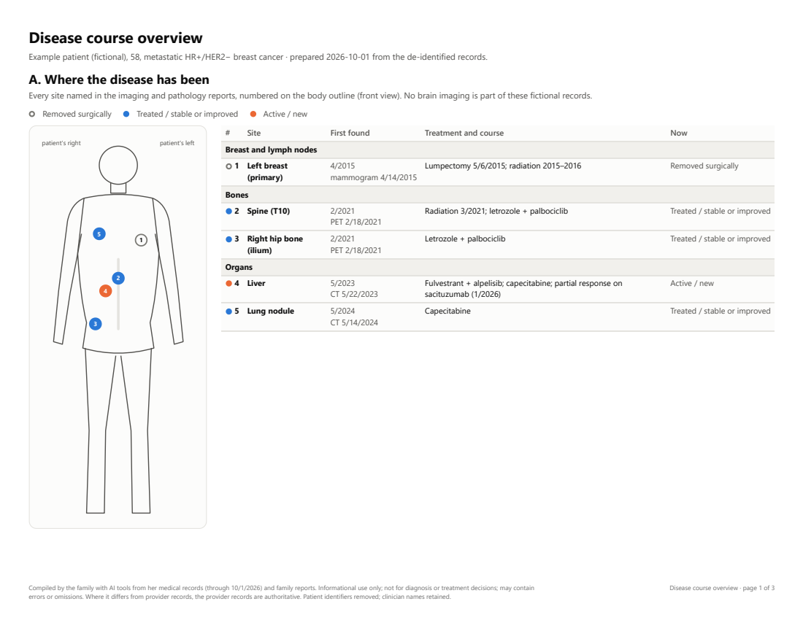
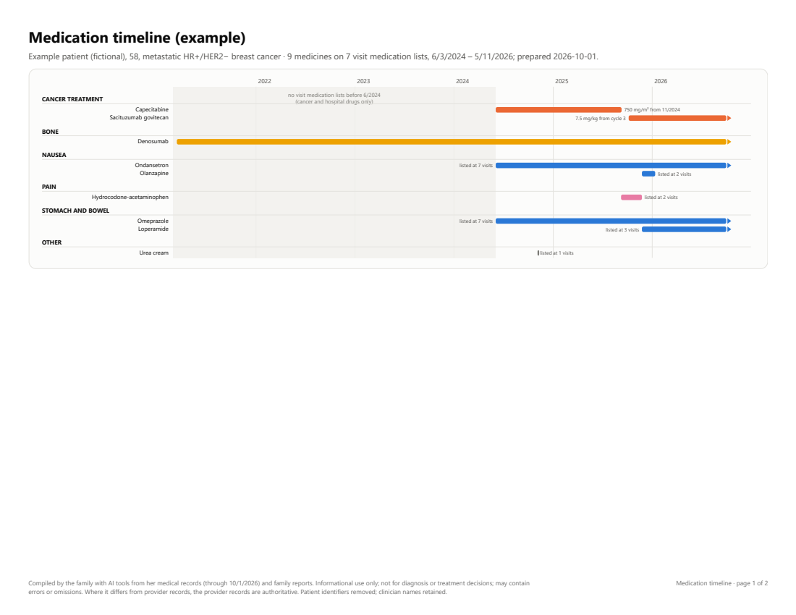
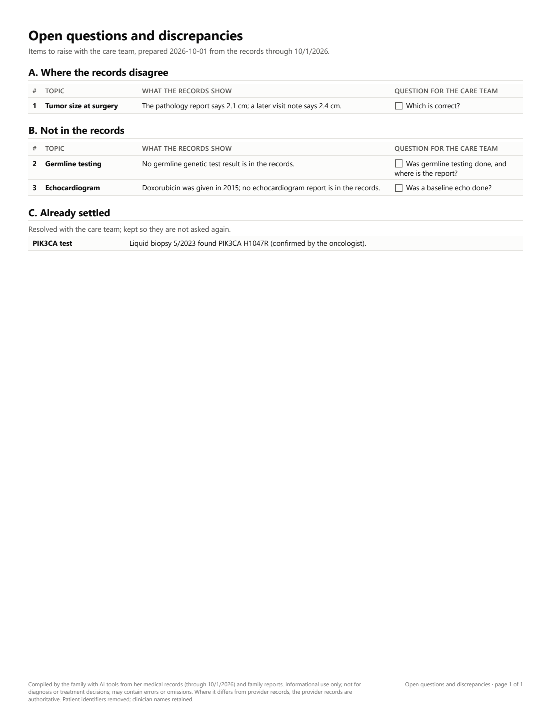
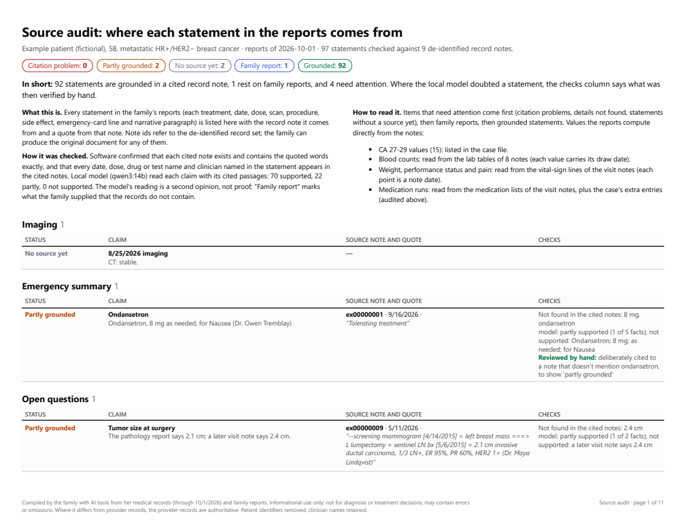
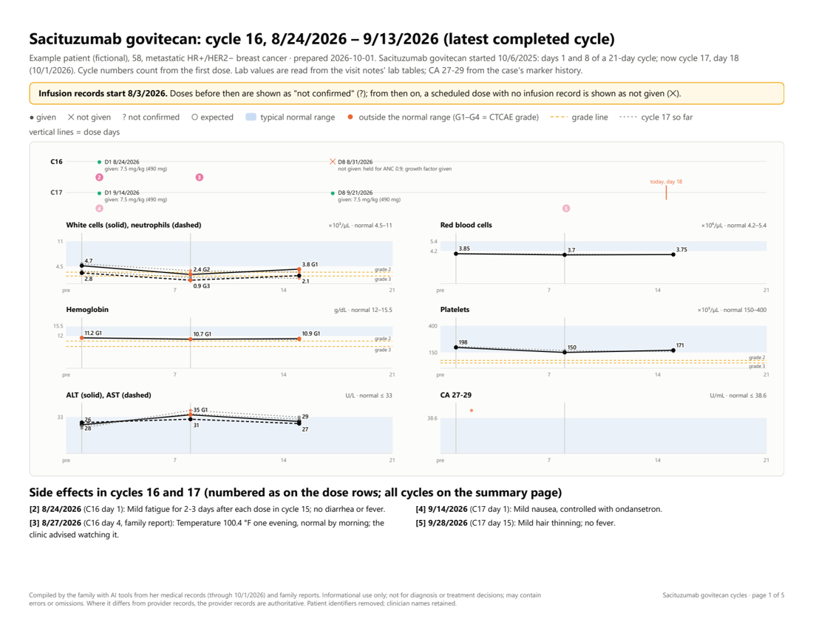

# PatientCentricRecords

**Turn a cancer patient's scattered medical records into a clear treatment history: timelines, tables and summaries
the family can read and bring to appointments. The identifying details are removed on your own computer first, so the
AI that helps write the reports never sees them.**

Years of cancer care leave records spread across portals, hospitals and paper files: hundreds of visit notes, each
repeating part of the story, none of them showing the whole course at a glance. PatientCentricRecords gathers them,
removes the patient's identifying information locally, puts everything in date order, and then lets a hosted AI
assistant (Claude) help the family build reports from the de-identified notes:

- a full treatment timeline with charts (systemic therapy, radiation, surgery, hospital stays, imaging, tumor markers);
- a one-page table of every cancer treatment: drug, prescriber, dates, side effects, why it stopped;
- a two-page emergency and travel summary (PDF and an editable Word file);
- pathology and genomic test results alongside the treatments they informed;
- blood counts, weight and performance status, and medication timelines;
- a list of open questions and discrepancies to raise with the care team;
- a source audit: every statement in the reports traced to the record note it comes from.

> [!IMPORTANT]
> **Not medical advice, and not a medical device.** This is a personal record-keeping tool. Its reports are compiled
> by software and an AI assistant from the records you give it, and they can contain errors and omissions. They are
> for organizing information and preparing questions, not for diagnosis or treatment decisions. The patient's care
> team and the original records are always authoritative. Every report carries a disclaimer saying so.

## See what it makes

All of these come from the **fictional example patient** in [`examples/case`](examples/case/). Build them yourself
with `python -m reports build --case examples/case --out examples/out`.

| | | |
|:--:|:--:|:--:|
| <a href="docs/images/full-timeline.png"></a><br>**Full treatment timeline** | <a href="docs/images/treatments-table.png"></a><br>**Every cancer treatment** | <a href="docs/images/emergency-summary.png"></a><br>**Emergency and travel summary** |
| <a href="docs/images/pathology.png"></a><br>**Pathology and genetics** | <a href="docs/images/blood-counts.png"></a><br>**Blood counts and doses** | <a href="docs/images/disease-overview.png"></a><br>**Disease overview** |
| <a href="docs/images/medications.png"></a><br>**Medication timeline** | <a href="docs/images/open-questions.png"></a><br>**Open questions for the care team** | <a href="docs/images/source-audit.png"></a><br>**Source audit** |
| <a href="docs/images/chemo-cycles.png"></a><br>**Chemotherapy cycles** | | |

## How privacy works

```
 Sources/               your computer only                                           hosted AI
 ┌────────────┐   ┌──────────────────────────────┐   ┌─────────────┐    ┌──────────────────────────┐
 │ portal PDFs│   │ pipeline: rules + identifier │   │ leak check  │    │ Claude reads filtered/,  │
 │ hospital   │──▶│ list + local LLM (Ollama)    │──▶│ FAIL / WARN │──▶ │ drafts the case file;    │
 │ XML, scans │   │ find names, IDs, addresses   │   │ blocks if   │    │ reports are built from   │
 └────────────┘   └──────────────────────────────┘   │ anything is │    │ the case file            │
       ▲                 private/ (identifiers,      │ left        │    └──────────────────────────┘
       │                 cache, review page)         └─────────────┘           filtered/ → analysis/
  never read by Claude
```

1. **The raw records stay local.** They live in `Sources/`, which is git-ignored. Claude Code is denied access to it
   and to `private/` by permission rules and a hook that blocks shell commands naming either folder.
2. **De-identification runs locally.** Three independent layers find identifiers: pattern rules (dates of birth, phone
   numbers, record numbers, addresses), the list of known identifiers you write in `private/identifiers.toml`, and
   a language model running on your machine through [Ollama](https://ollama.com). Every name found anywhere is then
   searched for everywhere. Nothing is sent over the network.
3. **A leak check gates publishing.** The de-identified notes reach `filtered/` only if no known identifier survives.
   Suspicious leftovers (anything shaped like a phone number or a name) block publishing until you review them.
4. **Only then does the hosted AI help.** Claude reads `filtered/` to answer questions and draft the case file, and
   the reports are built from that case file.
5. **Every statement is checked against its source.** The source audit traces each statement in the reports to a
   quote in a record note, or labels it a family report, and the local model reads each one as a second check.

[docs/architecture.md](docs/architecture.md) shows how the parts fit together.

**What is kept on purpose:** clinical dates (the sequence of treatment is the point), the patient's age on each
date (the date of birth is removed), and the names of clinicians and facilities (so you can ask "what did Dr. X
prescribe?"). The patient's own name, family, contacts, record numbers, addresses and phone numbers are removed.
Because dates are kept, this is **not** HIPAA "Safe Harbor" de-identification. It is designed to protect the
patient's identity when the family uses a hosted AI, not to make records safe to publish.

**No de-identification is perfect.** Review the highlighted redactions in `private/review/index.html` before relying on
the output, add anything missed to `private/identifiers.toml`, and rerun. Treat `filtered/` and the reports as
sensitive health information.

> [!NOTE]
> **About HIPAA.** HIPAA's privacy rules apply to healthcare providers, health plans and their business associates.
> They generally don't govern a patient, or a family member helping them, using the patient's own records. A hosted
> AI service is not the patient's provider, though: read its privacy terms and your account's data settings before
> you start. Use this tool only for records you have the right to use (your own, or a family member's with their
> permission). It is not designed for providers or organizations processing patient data on others' behalf.

## What you need

| | Required? | Notes |
|---|---|---|
| **Python 3.11+** | yes | Windows, macOS or Linux |
| **[Ollama](https://ollama.com/download)** with a suitable model | yes | `python -m pipeline doctor` picks one from what you have installed, or suggests one. The recommended `qwen3:14b` needs about 11 GB of GPU memory (an NVIDIA or AMD card, or an Apple Silicon Mac with 16 GB+). It also runs on the CPU, several times slower. |
| **[Claude Code](https://claude.com/claude-code)** | for the reports | reads the de-identified notes and drafts the case file |
| Chrome, Edge or Chromium | for PDFs | reports print to PDF through a headless browser |
| [Tesseract](https://tesseract-ocr.github.io/tessdoc/Installation.html) | for scanned records | local OCR |
| [Node.js](https://nodejs.org) | for the Word file | the editable emergency summary |

The first full run is slow: a few minutes per long note on a GPU, much longer on a CPU. Every result is cached, so
later runs take seconds.

## Quick start

The short version is below. [docs/getting-started.md](docs/getting-started.md) is the step-by-step guide for
Windows, macOS and Linux.

```bash
git clone https://github.com/jreves/PatientCentricRecords.git
cd PatientCentricRecords
python -m venv .venv
source .venv/bin/activate        # Windows: .venv\Scripts\activate
pip install -e ".[ocr,dev]"
python -m pipeline init          # creates Sources/, private/, filtered/, analysis/ and two files for you to edit
python -m pipeline doctor        # checks Python, GPU, Ollama and the model, Tesseract, Node, browser
```

Then:

1. **Add the records.** Download the patient's records (patient portals usually offer PDF and "download my record"
   XML exports) into subfolders of `Sources/`, and list each subfolder in `config/local.toml`.
2. **Fill in `private/identifiers.toml`** yourself, in a text editor: the patient's names (including maiden name and
   nicknames), date of birth, record numbers, address, phone numbers, and the names of family and contacts. Don't ask
   Claude to do this: it must never see this file.
3. **Run the pipeline:** `python -m pipeline run`. It prints only counts and document ids, never note text.
4. **Review** `private/review/index.html` in your browser. Add missed identifiers to `private/identifiers.toml`; add
   wrongly redacted words (a drug or a clinic taken for a person) to `[allowlist]` in `config/local.toml`. Rerun
   until it prints `PUBLISHED` and you're satisfied. If it reports warnings, read `private/verify_report.md`, and once
   you've checked every one, run `python -m pipeline run --accept-warnings`.
5. **Build the case file with Claude.** Open Claude Code in this folder and ask it, for example, to "read
   `filtered/all_notes_chronological.md` and draft `analysis/case/` following `docs/case-file.md`, citing the note
   behind each statement in `citations.yaml`". Check what it writes against the records: you know the history better
   than any summary.
6. **Build the reports:** `python -m reports build`. They appear in `analysis/`.
7. **Check the source audit** before handing the reports to a new physician. Each build ends with
   `analysis/source_audit_<date>.pdf`, listing every statement in the reports with the record note it comes from and a
   quote from that note. Software checks that the quote and every date, dose and drug in the statement are in that note,
   and the local model reads each one as a second check. Fix or cite whatever it flags (`docs/case-file.md`).

To see what the reports look like first, build the fictional example: `python -m reports build --case examples/case --out examples/out`.

When new records arrive, add them to `Sources/` and rerun. Only the new documents go through the model.

## Documentation

| Guide | For |
|---|---|
| [Getting started](docs/getting-started.md) | setting up, from installing the tools to the first reports |
| [Gathering records](docs/gathering-records.md) | which portal records are worth downloading, and how detailed |
| [When new records arrive](docs/updating-records.md) | the routine for folding in new records |
| [The source audit](docs/source-audit.md) | reading the audit appendix and acting on it |
| [How it fits together](docs/architecture.md) | the local and hosted halves, and what each can see |
| [De-identification](docs/de-identification.md) | what's removed and kept, and how to tune it |
| [The case file](docs/case-file.md) | every key in the case file and its citations |
| [Working with Claude](docs/working-with-claude.md) | using Claude Code safely with this project |
| [Troubleshooting and FAQ](docs/troubleshooting.md) | when something goes wrong |
| [Contributing](CONTRIBUTING.md) · [Security](SECURITY.md) | helping, and reporting privacy problems privately |

## Repository layout

| Folder | What it holds | In git? |
|---|---|---|
| `Sources/` | the raw records, one subfolder per source | no, never |
| `private/` | identifiers, caches, review page, leak-check report | no, never |
| `filtered/` | the de-identified notes, published by the pipeline | no |
| `analysis/` | the case file and the built reports | no |
| [`config/`](config/) | shared settings; your `local.toml` overlay (git-ignored) | shared part only |
| [`pipeline/`](pipeline/) | the local de-identification pipeline (`python -m pipeline`) | yes |
| [`reports/`](reports/) | the report engine (`python -m reports`) | yes |
| [`examples/`](examples/) | a fictional case to try the reports on | yes |
| [`docs/`](docs/) | how de-identification works, the case-file reference | yes |
| [`tests/`](tests/) | regression tests on invented records | yes |
| `.claude/` | Claude Code permission rules and the privacy hook | yes |

The data folders are created by `python -m pipeline init`, each with a README explaining it. `.gitignore` is an
allowlist, so new folders of data are ignored by default.

## Commands

```bash
python -m pipeline doctor [--bench]     # environment check; --bench scores the model on a synthetic note
python -m pipeline run                  # de-identify everything; publishes only if the leak check passes
python -m pipeline run --accept-warnings  # after you have reviewed every warning
python -m pipeline verify               # re-check the published notes (e.g. after adding identifiers)
python -m pipeline audit                # de-identification: count-only check for over-redaction (drugs taken for people)
python -m pipeline ids                  # count-only inventory of record numbers found
python -m reports build [--only NAME]   # build the reports from analysis/case
python -m reports audit [--suggest]     # reports: the source audit (every statement cited and checked); --suggest proposes citations
python -m reports cycles --discover     # propose chemotherapy regimens and their cycles from the notes (cycles.suggested.yaml)
python -m pytest -q                     # tests (synthetic data only)
```

## Limitations

- The note-type and date heuristics were developed on one oncology practice's portal exports and one hospital
  system's exports. Other formats work, but may need tuning (`pipeline/chrono.py`, `pipeline/sections.py`).
- The report engine draws what the case file says. It doesn't interpret the records: the case file is only as good
  as the review it gets.
- English-language records only.

## Contributing

Issues and pull requests are welcome. **Never include real patient data** in an issue, a pull request, a test or a
screenshot: describe problems with invented examples, as the tests in `tests/` do. The issue forms ask you to confirm
this before you submit.

If you find a **privacy problem** (identifying information reaching published output, or Claude Code able to see
something it shouldn't), please report it privately through the repository's
[security advisories](https://github.com/jreves/PatientCentricRecords/security/advisories/new), not in a public issue.

## License

[Apache License 2.0](LICENSE).
