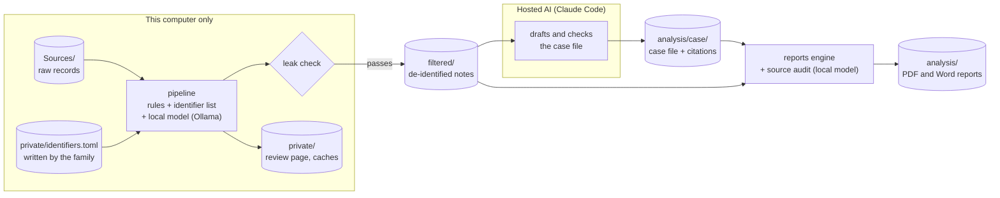

# How it fits together

PatientCentricRecords has two halves with a wall between them. On the **local** side, the raw records are read and
de-identified on the family's own computer. On the **hosted** side, an AI assistant (Claude) helps turn the
de-identified notes into reports. The wall is the leak check: nothing reaches the hosted side until it passes.

## What runs where

| Step | Runs | Reads | Writes |
|---|---|---|---|
| `pipeline run` | locally, with Ollama on this computer | `Sources/`, `private/identifiers.toml` | `private/` (review page, caches), and `filtered/` if the leak check passes |
| Writing the case file | Claude Code (hosted), guided by the family | `filtered/`, docs | `analysis/case/` |
| `reports build` | locally | `analysis/case/`, `filtered/` | `analysis/` |
| Source audit | locally, with Ollama | `analysis/case/`, `filtered/` | `analysis/source_audit_*.pdf` |

## What the hosted AI can and can't see

**It can read** the de-identified notes in `filtered/`, the case file and the reports, the code and docs, and
whatever the pipeline prints, which is counts and document ids only.

**It's kept away from** `Sources/` and `private/`, three ways:
1. Claude Code's permission rules (`.claude/settings.json`) deny reading, editing or writing there.
2. A hook (`.claude/hooks/guard_private.py`) refuses any shell command, search or file operation that names either
   folder.
3. The pipeline never prints record text, model output or identifiers, so even its error messages are safe to show.

The local model's address must be on this computer: the pipeline refuses any other host, because raw text is sent to
it.

## What de-identification keeps and removes

| Removed | Kept, on purpose |
|---|---|
| the patient's names, date of birth, record and account numbers, phones, emails, addresses, home town | clinical dates (the order of treatment is the point) |
| family members and contacts | the patient's age on each date |
| specimen numbers; device serial and lot numbers | clinician, facility and pharmacy names (so "what did Dr. X prescribe?" works) |
| | implant manufacturer, model, size, catalog number and GS1 device identifier (what a surgeon needs) |
| | diagnoses, drugs, doses, results, staging |

Because dates are kept, this is **not** HIPAA "Safe Harbor" de-identification. It's designed so the family can use a
hosted AI without exposing the patient's identity, not to make records safe to publish.
[de-identification.md](de-identification.md) has the details.

## The parts of the code

| Folder | What it is |
|---|---|
| `pipeline/` | reading records (PDF, Word, Excel, C-CDA XML, OCR), detection, the name registry, redaction, dating, the leak check, `doctor` |
| `reports/` | the report engine, the timeline renderer, the source audit |
| `config/` | shared settings; each installation's own settings go in `local.toml` (git-ignored) |
| `examples/case/` | a fictional patient's case file and notes, to try the reports on |
| `tests/` | regression tests on invented records |
| `.claude/` | Claude Code permission rules and the privacy hook |
