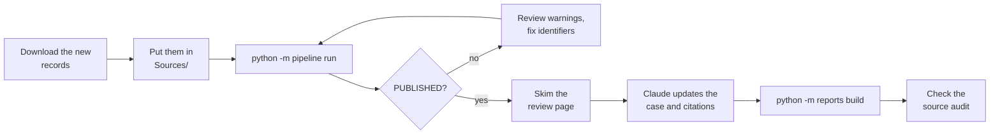

# When new records arrive

Records keep coming: a new visit note, a scan report, a hospital stay, a pharmacy printout. This is the routine for
folding them in, usually 15–30 minutes of your time.



## 1. Add the files

- **Put each file in the matching folder under `Sources/`.** A brand-new kind of source, such as a new clinic's portal
  or vaccination records, gets its own subfolder and a new `[[sources]]` block in `config/local.toml`.
- **Re-downloading something you already have does no harm.** Duplicates are recognized by content and skipped.
- **Prefer text PDFs or the portal's XML export over scans and photos.** A one-page scan without text is dropped unless
  OCR is turned on for its source, and the run log says so.

## 2. Run the pipeline

```bash
python -m pipeline run
```

Only the new documents go through the local model; everything else comes from the cache. Check the last lines it
prints:
- `PUBLISHED N notes`: done.
- `NOT PUBLISHED`: handle the FAILs and WARNs as in [getting-started.md](getting-started.md#6-de-identify-them).

New people in the new records (a new surgeon, a new caregiver) are found automatically. Still skim
`private/review/index.html` for the new documents: it's the only place you see what was removed.

## 3. Update the case

Ask Claude Code, for example:

> The pipeline published new notes. Read the ones added since the last build, tell me what's new, and update the case
> and its citations. Ask me before changing any wording that's already there.

Things to expect and check:

| What | Why |
|---|---|
| **New events and results** | added to the case, each with a citation |
| **Facts you reported that a record now documents** | switched from "family report" to the record. For example, a vaccine you mentioned now appears on a pharmacy printout. |
| **Contradictions** | a new note may disagree with an old one, or carry an old note's text forward word for word. These become **open questions** for the care team rather than silent edits. |
| **New infusion days** | each infusion record adds a dose to the chemotherapy cycles report; a scheduled day with no record shows as not given. If a record is wrong (a dose you know was given), say so: it goes in as a family report |
| **Dates** | `dates.records_through` in `analysis/case/case.yaml` moves to the newest record, and `built` to today |
| **Your current medication list** | when you send a new one, its "Updated" date becomes the date it's authoritative from (`audit: authoritative:` in the case) |

## 4. Rebuild and check

```bash
python -m reports build
```

Open the new `source_audit_<date>.pdf`. Its first lines say how many statements need attention, and those come first
in the list. When it says **0 need attention**, the reports are ready to share. Older builds can be kept: move them
to a subfolder of `analysis/` if you like.

## Good habits

- **Keep the original downloads.** The pipeline never changes them, and the family may need to produce an original
  document for a physician.
- **Back up `Sources/` and `private/` together,** and keep the backup as safe as the records themselves.
- **Bring the open-questions page to the next appointment.** Settled questions move to its "already settled" section,
  so they aren't asked twice.
